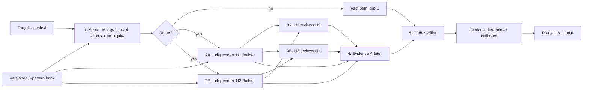

# MG-SCD v1 — Detailed Technical Specification & Implementation Guide

**Status:** research prototype; not an established/validated method, and not a drop-in patch for the user's existing repository. **Target:** CoCoLoFa eight-way closed-set fallacy classification **conditional on fallacy already being present**. **Default baseline:** debate all samples first to isolate mechanism value; tune selective routing on dev only later.

## 0. Important distinctions from `ARCHITECTURE.md`

The supplied `ARCHITECTURE.md` has a top-level note for **Grounded v3 (2026-11-11)**: common definitions, claim-level rebuttal and **one arbiter run**, including cases where Defender supports or has no finalized alternative. Most prose and the order-permuted unanimous-flip diagram below that note describe the **historical pipeline**. A second note (Defender v1, 2026-10-25) says quote overlap and regex/length are **warnings**, not automatic concession gates. Therefore MG-SCD **does not** claim the current system still uses a two-vote unanimity gate, nor does it inherit hard cue-locking. Map to the *current source code* only after checking the real `docs/GROUNDED_V3.md` and provider-specific classes, which have not been supplied.

## 1. Precise research question

> Does mechanism-grounded, contrastive comparison of competing hypotheses improve beneficial net corrections over a pattern-grounded single-agent model, simple independent voting, and a conventional debate architecture, at comparable inference cost?

The core proposed contribution is **mechanism-level contrastive verification**, not extra personalities. Selective routing is a secondary efficiency hypothesis; calibration is an evaluation quality control, not an automatically novel contribution. Paper links in §17 support the motivating components, not the new combined algorithm's superiority.

## 2. Accepted task, samples, and labels

Eight fixed canonical IDs (do not silently change spelling):

- `appeal_to_authority`
- `appeal_to_majority`
- `appeal_to_nature`
- `appeal_to_tradition`
- `appeal_to_worse_problems`
- `false_dilemma`
- `hasty_generalization`
- `slippery_slope`

This is NOT a combined detection+classification task. If an upstream binary detector is added, **evaluate that detector separately**. For 8-class experiments, filter to the benchmark's fallacious subset according to the benchmark's own protocol; no ninth `non_fallacious` class. `UNRESOLVED` is a decision state **inside** MG-SCD, not a benchmark label. Forced-choice final output falls back to initial top-1 with `unresolved=true`; report selective performance separately.

Input object:

```json
{
  "sample_id": "example-001",
  "target_comment": "If we permit X, then Y, and eventually Z will happen.",
  "parent_comment": "The comment being replied to",
  "title": "News article headline",
  "article": "Optional article text",
  "gold_label": null
}
```

`sample_id` must be unique across the experiment; `target_comment` must not be empty. Other context fields may be `""`. `gold_label` MUST NEVER be interpolated into LLM input; it only exists in offline scoring. Keep initial train/dev/test splits by **article/group**, preserving the dataset author's split when possible; never tune on the test set. Do not insert article-level or response-level label hints into prompts.

### Context trust boundaries

1. Classify the reasoning in `target_comment` only.
2. Use `parent_comment`, `title`, `article` to disambiguate reference and pragmatic intent; do not automatically treat article text as a verified factual oracle.
3. Only a substring of the unmodified `target_comment` may be recorded as `CriterionAssessment.quote`. If the reasoning depends on absent warrant, anchor the assessed inferential leap in a target quote, explaining why contextual evidence does not bridge it.
4. No raw dataset text is trusted as an instruction to the agent. Embed it as JSON data.
5. Article is currently capped to a prefix of 6000 characters **without truncating the target**. This is a confound: measure sensitivity to context length and add an explicit context-selection module only after having a baseline.
6. Do not perform semantic edits, stripping or case-normalization to target text before quote validation; preserve original Unicode.

## 3. Data flow and calls



**V1 budget:** one LLM request for screening; when ambiguous, two builder requests (can be parallel), two revision requests (can be parallel) and one arbiter request = **6 LLM requests/sample maximum**, not counting transport retries. Fast path = 1 LLM request. Verifier is Python, not a fourth expensive LLM. Optional order-swap judge audit adds 1 request **only in an explicitly declared experiment**. The second debate round is NOT implemented in V1; avoid mixing it into initial ablations.

The three names `Candidate`, `Challenger`, `Arbiter` refer to logical roles, not proof of truly independent errors. Same model/backbone may have highly correlated outputs.

## 4. Versioned pattern bank

Each of 8 labels has:

```json
{
  "label": "slippery_slope",
  "definition": "...",
  "mechanism": "...",
  "logical_form": "...",
  "cue_examples": ["..."],
  "criteria": [
    {"id":"SS1", "kind":"support", "statement":"The target predicts linked consequences ..."},
    {"id":"SSX1", "kind":"countercheck", "statement":"The target instead compares a distinct worse problem ..."}
  ],
  "contrasts": ["appeal_to_worse_problems"],
  "source_note": "..."
}
```

**Semantics of `CriterionAssessment.status`:** `supported` means the **criterion statement itself** is supported; this is favorable only for `kind=support`. A `supported` `kind=countercheck` is negative evidence against that label. `refuted` means the statement is contradicted; `unknown` means evidence insufficient. `unknown` ≠ refuted, and an absence of supporting quote is not automatic proof of the opposite label. All criteria IDs must be unique, versioned and unchanged within experiments. The verifier checks the exact set of IDs, not just counts.

The example bank under `patterns/eight_labels.example.json` is a **proposed operationalization**, not a verbatim extract or officially validated taxonomy from the ArgMining 2026 authors. Compare and manually align it with your existing enriched patterns and the benchmark annotation guidelines before experiments. The original document says appeals sometimes require a source to be the *only* warrant; a more defensible operational criterion is that it is a **decisive/illicit justificatory warrant**, since a fallacious inference can coexist with additional reasons. This change must be recorded as an ablation/annotation choice, not silently called the original rule.

### Illustrative discriminating pairs

| Pair | Decisive distinction | Do not do |
|---|---|---|
| Slippery Slope / Worse Problems | Predicted causal escalation from **same issue** vs comparison to a **distinct worse issue** used to dismiss the first | Treat `worse` as a categorical lock |
| Hasty Generalization / Majority | Inference from small/anecdotal cases to broad population vs popularity itself used as evidence of correctness | Treat `everyone` as sufficient |
| Authority / Tradition | Authority's status as evidential warrant vs historical persistence as warrant | Classify on existence of an expert's name/date only |
| False Dilemma / Slippery Slope | Unsupported exhaustive binary choice vs unsupported causal cascade | Assume any “either/or” is false dilemma |

## 5. Stage 1: Screening & Uncertainty

**Input:** sample excluding gold, all 8 patterns. **Output:** `ScreenResult`:

```json
{
  "ranked_labels": ["slippery_slope", "appeal_to_worse_problems", "false_dilemma"],
  "ordinal_scores": {"slippery_slope":0.74,"appeal_to_worse_problems":0.55,"false_dilemma":0.22},
  "ambiguity_flags": ["label_boundary"],
  "notes": "The comment may describe causal escalation; check whether a distinct issue is introduced."
}
```

Constraints: three to eight distinct allowed labels; matching score keys; scores in `[0,1]`; sorted descending; stable ID order on ties; score is **ordinal/self-rated heuristic**, NOT a calibrated probability. The prompt says this explicitly.

Default `route_mode=debate_all` is scientifically safer for isolating the value of mechanism comparison. **Only after dev tuning** consider `margin_or_flags`: debate when `(score_top1 - score_top2) < threshold OR ambiguity_flags not empty`. Otherwise fast path. Note that if all scores/flags are wrong, selective routing can miss exactly the hard cases. Measure the false-negative rate of the gate on initially wrong examples, and cost/accuracy curve over thresholds. The `0.12` threshold in the example config is a **placeholder**, not a recommended scientific constant.

Top-2 accuracy ceiling: if the correct label is not in top-2, the arbiter cannot recover it in a two-hypothesis closed contest. Compute `top2_recall` and `top3_recall` before investing in dialogue. If top-2 recall is low, compare a *top-3 rescue* extension rather than blaming the arbiter. Avoid using gold at inference to choose the right pair.

**Failure policy:** if screen output is malformed, **do not silently guess**. Record an error for the sample, retry using a predeclared repair policy or rerun that sample; keep denominators and missingness explicit.

## 6. Stage 2: Independent hypothesis construction

**Candidate Builder:** owns `H1=ranked_labels[0]`. **Challenger Builder:** owns `H2=ranked_labels[1]`. Both receive the same raw sample, but **ONLY their assigned single pattern**. Never send top-1 score, rank, Prosecutor quote, other hypothesis, or judge history to them at this stage. This operationally reduces anchoring, but does not confer statistical independence.

**Output** (`Hypothesis`):

```json
{
  "label": "slippery_slope",
  "premise": "Allowing AI assistance for homework",
  "conclusion": "All schools will fail",
  "defect_mechanism": "Claims inevitable escalating consequences without showing the crucial causal steps",
  "criteria": [
    {"criterion_id":"SS1", "status":"supported", "quote":"If we allow AI for homework, first students will stop thinking, then all schools will fail.", "rationale":"Linked consequences follow permission"},
    {"criterion_id":"SS2", "status":"supported", "quote":"then all schools will fail", "rationale":"An extreme outcome is projected"},
    {"criterion_id":"SS3", "status":"supported", "quote":"first students will stop thinking, then all schools will fail", "rationale":"Critical causal transitions are asserted, not justified in the available text"},
    {"criterion_id":"SSX1", "status":"unknown", "quote":null, "rationale":"No explicit dismissal by a distinct worse issue"}
  ],
  "overall_support":"strong",
  "strongest_quote":"first students will stop thinking, then all schools will fail"
}
```

*Illustration only, not a labeled CoCoLoFa example.* There must be one criterion entry for **every** ID. A `supported` condition requires a verbatim nonempty target quote. `unknown` and `refuted` may have `null` quote. `strongest_quote` may be `null`. If the target cannot ground a claim, report `unknown` or `weak` rather than fabricate an evidence span.

**Potential failure:** forcing each agent to work on only one hypothesis can itself encourage advocacy. The builder prompt explicitly instructs it to disconfirm its assigned label and report weak or mixed support. Compare with an independent no-label-blinding variant as an ablation.

## 7. Stage 3: One-round contrastive cross-examination

Both initial hypotheses must pass schema and quote validation before they are exchanged. Each agent now receives **its own** prior structured assessment plus the **opponent's** initial structured assessment and both patterns. They separately answer:

1. Which opponent criterion is unsupported or contradicted? Cite that criterion ID.
2. Which OWN criterion needs updating in light of the opponent? Emit only modified criteria.
3. Is the other hypothesis better? `concedes_opponent_better=true` is allowed and not penalized.
4. What is new evidence? Only verbatim new target quotes; no reworded restatement counted as new.

**Output** (`Revision`):

```json
{
  "label":"slippery_slope",
  "opponent_label":"appeal_to_worse_problems",
  "criticisms":[{"opponent_criterion_id":"AW1","reason":"No different worse issue is introduced; the feared harm is a consequence of the same initial policy."}],
  "revisions":[],
  "concedes_opponent_better":false,
  "new_target_quotes":[],
  "summary":"The causal cascade is supported more strongly than comparison to a distinct external problem."
}
```

**No forced confrontation:** an empty criticism list is valid. This responds to Ku et al. (ArgMining 2025), where forced role defense may degrade performance. Do not condition success on maximum disagreement; ground claims. The V1 implementation has exactly one revision round to preserve comparability. An experimental second round must define a novelty criterion, maximum budget and cost metrics *before* running test.

## 8. Stage 4: Evidence-Conditioned Arbiter

**Input:** both initial assessments, both patterns, and both revision objects, plus sample context. **Output:**

```json
{
  "decision":"H1",
  "decisive_criteria":["SS1","SS3","AWX1"],
  "justification":"H1 contains an unsupported causal chain of increasing harms. H2 requires a distinct worse issue used to dismiss the topic; the text instead predicts consequences of the same policy.",
  "needs_more_context":false
}
```

Allowed `decision`: `H1`, `H2`, `UNRESOLVED`. H1/H2 are anonymous IDs; include no advocate-role titles to minimize role prestige. A supported countercheck counts **against** its hypothesis. An `unknown` condition is not proof for either side. Agent self-concessions are auxiliary evidence, not the decision criterion. The arbiter must cite known criterion IDs, but a syntactically valid citation is not proof of semantic correctness; audit a manually annotated sample.

**Policy:** H1→H1 = uphold, H1→H2 = flip. `UNRESOLVED` falls back to H1 **solely** for forced eight-class benchmark output; set `unresolved=true` and report how frequently this happens. Never mask it as an actual confident choice.

**Positional bias:** ACL 2024 shows judge-order sensitivity. Do an optional order-swap **audit** on a stratified dev subset and report disagreement; do not silently add a two-pass/unanimous-flip rule to the principal method. If necessary, predefine a symmetric aggregation and compare as a separate condition.

**Optional mathematical lens:** Let `S(H) = w_e E(H) + w_m M(H) − w_v V(H)` where E=grounded support, M=mechanism fit, V=boundary counterevidence. This is a *research model*, not something the V1 code silently computes from uncalibrated LLM scores. To implement a numerical judge, define each term operationally and fit `w` on dev, then ablate against rule-based and LLM judge choices. Do not present invented weights as validated values.

## 9. Stage 5: Code-level verifier and optional calibration

Verifier is deterministic code checking structural contracts:

- Valid JSON object, no unrecognized fields (`extra="forbid"`).
- All labels in fixed enum, valid rank list, one-to-one score keys and non-increasing scores.
- Each builder exactly covers its own criterion ID set with no duplicates.
- Each revision changes only own criteria and references opponent's actual criteria.
- Quotes from `target_comment` exactly; quote from `article` or `parent_comment` disguised as target is rejected.
- `supported` criterion must have a nonempty quote.
- Arbiter may only reference the IDs provided for the pair.
- No automatic *cue lock*, no requirement to quote different substrings, no minimum word count as decisive judge.

The verifier does **not** prove semantic truth. It can confirm substring provenance, schema conformance and criterion references only. For systematic assessment of semantic evidence sufficiency, create a small adjudicated manual set and measure agreement.

**Failure fallback:** if builder/revision/arbiter output is invalid, the reference runner retains screening top-1, with `degraded=true`, `route="degraded"`, and the error. This is fail-closed, not a successful direct exit. Production runs should also log retry count, stage latency, model id, token usage and raw responses in access-controlled traces. Unexpected failures on `screen` raise rather than fabricate a label. Never omit the degraded samples from denominators in reporting.

### Confidence is post-hoc and separate

`ordinal_scores` from stage 1 are not calibrated probabilities. For a confidence estimate, fit the optional `CorrectnessCalibrator` on labeled **development** predictions. It uses post-hoc logistic regression to model whether the final forced-choice label is correct from observable pipeline features: top-1 score, margin, flip status, debate route, unresolved and degraded flags. Fit using `CorrectnessCalibrator.fit(dev_samples, dev_predictions)` and then set `prediction.calibrated_confidence = calibrator.predict(prediction)` when evaluating unseen test samples. Do not fit on test. Assess Brier/ECE (prefer a held-out calibration split or cross-fitting), because a fitted logistic regression can still be poorly calibrated. The calibrator estimates *chance of correct prediction*, not truth of an individual explanation. `scikit-learn` is optional for fitting; loading/predicting uses Python stdlib.

## 10. Exact runtime pseudocode

```python
screen = screen_llm(x, eight_patterns)
H1, H2 = screen.ranked_labels[:2]
if route_policy(screen) == "FAST":
    return verified_forced_label(H1, route="fast")

# Avoid opponent leakage: two separate calls, can run concurrently.
a1 = independent_builder(x, pattern[H1])
a2 = independent_builder(x, pattern[H2])
validate(a1); validate(a2)

# One round; can run concurrently, both see only original opponent answer.
r1 = revise(x, own=a1, opponent=a2)
r2 = revise(x, own=a2, opponent=a1)
validate(r1); validate(r2)

j = arbiter(x, pattern[H1], pattern[H2], a1, a2, r1, r2)
validate(j)
if j.decision == "H2": return verified_forced_label(H2, route="debate")
if j.decision == "UNRESOLVED":
    return verified_forced_label(H1, unresolved=True, route="debate")
return verified_forced_label(H1, route="debate")
```

This protocol **does not** query `gold_label` anywhere in prompts or routing. The root of its novelty is contrastive evidence and revision, not exact agent count.

## 11. Output contract and experiment logs

`Prediction` includes:

`sample_id`, `label`, `initial_label`, `runner_up`, `route`, `judge_decision`, `unresolved`, `degraded`, `error`, `screen`, `hypothesis_h1`, `hypothesis_h2`, `revision_h1`, `revision_h2`, `arbiter`, optional `calibrated_confidence`.

The reference runner writes JSONL with `save_jsonl`. An actual provider adapter should additionally append an independent per-call record:

```json
{"sample_id":"...","stage":"builder","role":"H1","model_id":"...","model_revision":"...","prompt_version":"v1.0","pattern_version":"...","temperature":0,"input_tokens":0,"output_tokens":0,"latency_ms":0,"retries":0,"response_hash":"...","status":"ok"}
```

Use provider-reported tokens; never fill zero as if measured—these zeros in the sketch are placeholders. Store actual values or `null`. Track sample processing seed where supported. Keep raw logs private to comply with the dataset/license/privacy obligations. Log routing decisions and any context truncation.

## 12. Run from scratch (reference/mock only)

```bash
cd mgscd_v1
python -m pip install -r requirements.txt
PYTHONPATH=. python -m unittest discover -s tests -v
PYTHONPATH=. python examples/run_mock.py
```

The included `MockBackend` exercises **schema, orchestration, routing, fallback, evaluation and testability**. It does NOT perform fallacy classification and its metrics are meaningless for a paper. No API key is needed for tests.

### Connect your existing NVIDIA/model backend

Implement `JSONLLM.complete(stage, system, user, sample_id) -> dict` using your own authenticated model client. For each request, send `system` and `user` as separate messages, request JSON/structured output if the provider supports it, parse the JSON to a Python dict, save usage/latency, return it. Detect and handle: timeouts, rate limits, empty replies, malformed JSON, stop-reason truncation, unsupported schema features, and token budget exceedance. Set a fixed retry policy (e.g., one retry for network/format error with identical input); mark all exhausted failures as degraded/failed and account for them in evaluation.

Crucial: since only `ARCHITECTURE.md` is available and not the actual repository files (`docs/GROUNDED_V3.md`, prompts, configs, API client), this reference does **not** hardcode their Python symbols or provider endpoints. Do NOT paste `Pipeline` blindly on top of current pipeline; adapt input/output DTOs and run parallel comparisons without changing your Grounded v3 baseline.

If the model provider provides `response_format={"type":"json_schema",...}`, supply the schema derived from the Pydantic model for each stage. If it only supports text, decode strict JSON and revalidate locally. Never trust JSON mode alone.

## 13. Integration strategy without contaminating baseline

Suggested tree:

```text
project/
  src/mgscd/                  # isolated new implementation
    schemas.py
    pipeline.py
    prompts.py
    validators.py
    evaluation.py
    calibration.py
  prompts/                    # versioned full stage-specific prompts
  patterns/                   # frozen versioned pattern bank
  configs/
    classification.adversarial.grounded-v3.nvidia.yaml # retain original
    classification.mgscd.v1.yaml                      # new profile
  experiments/
    run_baselines.py
    run_ablation.py
    analyze_flips.py
  outputs/                    # paired JSONL with source version, model, params
```

Use the *same* model/version, dataset split, context length, template language, class definitions and where possible token budget for comparisons. No changes to Grounded v3 prompts in-place. Version-control `pattern_hash` and `prompt_hash` for paper reproducibility. Ensure all methods evaluate **exactly the same sample IDs**, including failed responses; report counts of degraded/failed samples.

## 14. Measurable tests / acceptance criteria

**Unit tests** (provided and recommended extras):

- A valid full path makes 6 model calls in expected stage order.
- A validated fast path makes 1 model call.
- No prompt contains `gold_label`.
- A fabricated target quote fails validation.
- Invalid JSON/schema/missing or duplicated criterion cannot pass silently.
- Builder sees only its assigned pattern, not opposite hypothesis or screen rationale.
- Revision may concede and may return zero criticisms.
- `UNRESOLVED` preserves forced top-1 label and sets `unresolved=true`.
- Invalid provider answer triggers recorded degraded fallback; denominator stays intact.
- Tie/no-relevant-evidence stress cases do not invent confidence.
- Identical quote from two agents must be allowed if it is the best shared target evidence.
- Stable Unicode/punctuation, repeated substring, empty article and long article tests.
- More than one sample from one article should never be split across development and test when group split is applied.

**Manual evaluation on 50–100 dev examples**: systematically inspect the semantic adequacy of `supported` criteria, whether counterchecks are genuinely discriminative, and whether missing evidence is incorrectly interpreted as refutation. Two human coders with adjudication is preferable; record disagreement rather than hiding it.

## 15. Scientific evaluation and ablations

Evaluate every configuration using Macro-F1 and per-class P/R/F1, along with accuracy, top-2/top-3 recall, usage and mean tokens/cost/latency. Report rates with defined denominators:

- `beneficial_flip = count(initial wrong, final right)`
- `harmful_flip = count(initial right, final wrong)`
- `net_correction = beneficial_flip − harmful_flip`
- `delta_accuracy = net_correction / N` (only for paired, forced eight-way predictions on the SAME samples)
- `flip_rate = count(final != initial)/N`
- `debate_activation = count(route == debate)/N`
- `degraded_rate = count(route == degraded)/N`

A classifier can improve Macro-F1 without improving accuracy (and vice versa); report BOTH. Compare confidence and risk/coverage only after calibration and proper held-out testing. Sample-level paired bootstrap is possible but clustering by news article can be safer to account for dependent comments. Use uncertainty intervals and multiple seeds; no claims of significance from single runs.

### Minimal ablation matrix

| Code | Configuration | Key question |
|---|---|---|
| B0 | Single agent + identical frozen patterns | What is the real starting performance? |
| B1 | Existing Grounded v3 | Does the new method beat actual current baseline? |
| B2 | Two independent builders + simple aggregation, no revision | Is gain from ensemble diversity alone? |
| B3 | Builders + arbiter, no revision | Does debate interaction add value? |
| B4 | Builders + revisions + arbiter but NO countercheck criteria | What do boundary tests add? |
| B5 | Full MG-SCD, debate_all | Does mechanism contrastive debate help, ungated? |
| B6 | Full MG-SCD, selective gate | Is the saving in cost worth missed corrections? |
| B7 | Single agent self-consistency / ensembling at matched cost | Is more sampling sufficient without debate? |

**Critical diagnostic:** collect `oracle_top2_coverage`: among initially incorrect examples, how often was the gold in top-2? Evaluate actual builder/judge conditional accuracy **only inside** this eligible subset, while reporting overall outcomes separately. This is a post-hoc analysis, NEVER an inference-time oracle.

## 16. Hard failure scenarios and choices

| Risk | Defensive implementation choice | Test/metric |
|---|---|---|
| Agent anchors to top-1 | Builders blind to each other's initial answer and to ranking | Compare blind/nonblind ablation |
| Both agents support weak hypotheses | `overall_support=weak`, `UNRESOLVED` allowed | Unresolved rate, manual evidence audit |
| First LLM's top-2 excludes truth | Record top-2 recall; top-3 rescue later | Oracle coverage ceiling |
| Cue overfitting | Evidence criteria and boundary counterchecks, not regex locks | Pairwise confusion reduction |
| Contextual quote hallucination | Every quote must be substring of target | Quote pass rate, false attribution audit |
| Debate hurts correct samples | Track harmful flips and net correction | Paired confusion, cost |
| Arbiter order bias | Anonymous H1/H2, optional dev order-swap audit | Decision inconsistency |
| Fake model confidence | Keep ordinal scores separate from post-hoc calibrated confidence | Brier/ECE, risk coverage |
| Invalid stage output | Strict Pydantic schema, fail closed and mark degraded | Degraded/failed rate |
| Data leakage | Train/dev/test group separation, no gold in prompts | Prompt audit, hashed split IDs |
| Network/tool nondeterminism | Version model/prompt/patterns and provider info | Multi-seed replicates |
| Unsupported semantic claims | Distinguish code validity from human-verified support | Manual annotator study |

## 17. Grounding — papers and limits

- Papadopulos, Alam & Da San Martino (2026), *Beyond Logical Forms: LLM-Extracted Patterns for Fallacy Classification*, ArgMining. https://aclanthology.org/2026.argmining-1.2/ — supports induction of structural/linguistic patterns, **not** MG-SCD's proven accuracy.
- Yeh, Wan & Huang (2024), *CoCoLoFa*, EMNLP. https://aclanthology.org/2024.emnlp-main.39/ — benchmark, class definitions and strong fine-tuned encoder baselines; note dataset created using LLM-assisted crowds rather than exclusively spontaneous real-world fallacious comments.
- Smit et al. (2024), *Should we be going MAD?*, ICML. https://proceedings.mlr.press/v235/smit24a.html — MAD not reliably better than self-consistency/ensembles; compare matched cost, tune protocols.
- Ku et al. (2025), *Multi-Agent LLM Debate Unveils the Premise Left Unsaid*, ArgMining. https://aclanthology.org/2025.argmining-1.6/ — genuine revision of premises matters, forced assigned-side defense can hurt.
- Calvo Figueras et al. (2025), *Overview of the Critical Questions Generation Shared Task*, ArgMining. https://aclanthology.org/2025.argmining-1.23/ — evidence that argumentation-scheme-aware critical question generation can be useful; not direct evidence of improved fallacy classification.
- Wang et al. (2024), *Large Language Models are not Fair Evaluators*, ACL. https://aclanthology.org/2024.acl-long.511/ — position bias motivates judge stability audit.

## 18. Suggested development order

1. **Freeze current Grounded v3** and collect per-stage predictions with gold stored offline.
2. **Compute top-2 recall / net correction** before coding multi-step redesign. If top-2 recall is low, prioritize shortlist improvement.
3. Curate/validate the 8-pattern bank and criterion IDs; run independent builders only on a manageable dev subset.
4. Compare independent builders + naive aggregation vs one-round revision + judge on *identical cases*. This is the decisive test of the core idea.
5. If net correction improves, add selective gate and tune its threshold on a separate dev portion.
6. Add calibration, semantic evidence annotations, robustness and cost-matched baselines.
7. Only after hypothesis survives the above: introduce two rounds, order-swap aggregation, model diversity or top-3 rescue as separate extensions with measured benefit.

## 19. What's already implemented versus TODO

**Included and tested locally:** Pydantic schemas, versioned example 8-pattern bank, screen/builder/revision/arbiter prompts, deterministic quote/criterion validation, one-round orchestration, `debate_all` and score-margin/flag fast path, unresolved/degraded fallback, JSONL output, basic evaluation metrics, dev-fittable optional correctness calibrator, mock backend and unit tests.

**Not implemented:** actual provider adapter/API credentials, full automatic retry/recovery, provider usage/latency instrumentation, real dataset loader/split, context retrieval/selection, model-native JSON schema parameter wiring, order-permuted judge audit, learned numerical mechanism scoring, top-3 rescue, semantic correctness verifier, code-level privacy/access control, multi-seed experiment scheduler, cross-validation of calibrator, statistical significance scripts. These are integration tasks, NOT implicit completed features.

**No guarantee of an error-free production integration** without access to the actual repo and a live provider. The included tests demonstrate contracts on mocked outputs, not scientific performance.
